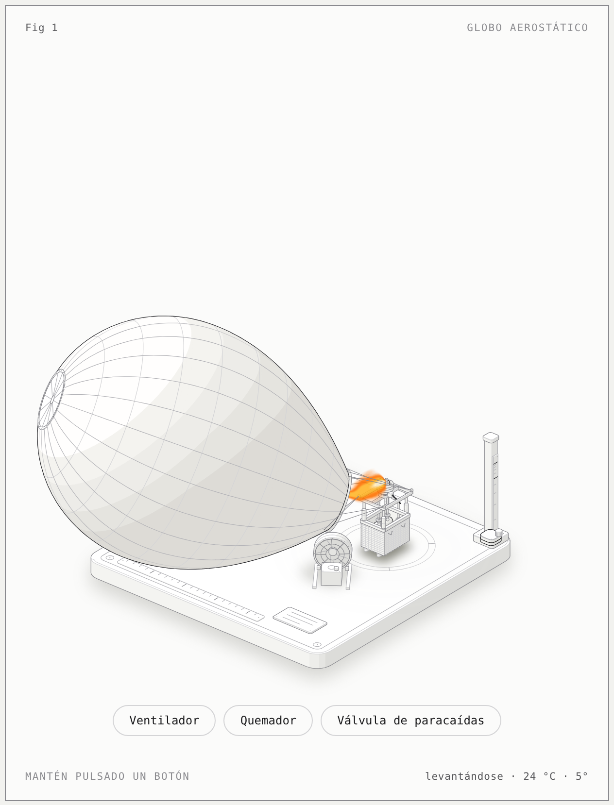

# Globo aerostático

Figura isométrica interactiva de un globo aerostático, hecha con la skill anatomy.

Abre `globo-aerostatico.html` (o la versión `-dark`) en el navegador. Para regenerarla: `node build.mjs`.

