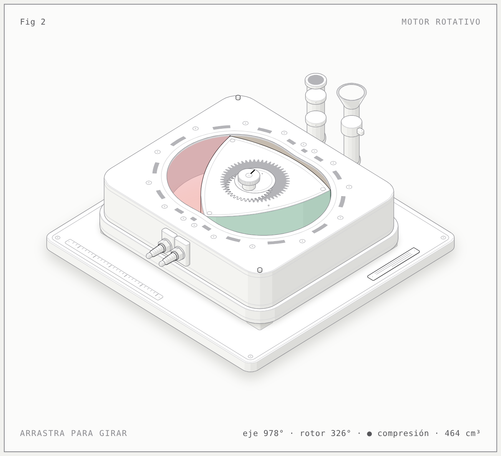

# Motor rotativo

Figura isométrica interactiva de un motor rotativo (Wankel), hecha con la skill anatomy.

Abre `motor-rotativo.html` (o la versión `-dark`) en el navegador. Para regenerarla: `node build.mjs`.

